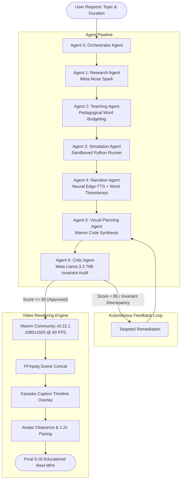

# Concept2Motion
### Autonomous Multi-Agent Engine for Technically Accurate Engineering Reels
*Powered by Meta AI (muse-spark-1.3 / llama-3.3-70b-instruct) & Manim Community*

---

## Overview

Concept2Motion is an autonomous multi-agent production system that transforms complex computer science, distributed systems, and kernel architecture topics into high-retention, 9:16 vertical engineering video reels (1080x1920 @ 60 FPS).

Most AI video generators prompt general diffusion models to hallucinate cartoonish visuals, or produce generic slide-deck cards with bullet points. Concept2Motion operates on an executable engineering foundation:

1. **Executable Ground Truth**: Algorithms and protocols are simulated in sandboxed Python environments to extract runtime states, register values, and mathematical invariants.
2. **Procedural Vector Mechanics (Manim Community)**: Visuals are rendered as clean vector animations (directed DAG nodes, active network links, traveling packet dots, sliding pointers, memory ring buffers, and fault-injection cuts) rather than text cards.
3. **Anti-AI-Slop Visual Craft**: Adheres strictly to restrained motion design standards (60-30-10 matte slate palette, `#07090E` background, `DejaVu Sans Mono` terminal typography, zero script-mirroring cards, and strict lower-third safe zones for avatar clearance).
4. **Autonomous Self-Auditing Loop**: An independent Critic agent audits algorithmic invariants against simulation traces and triggers targeted self-correction before rendering.

---

## System Architecture



---

## The 7 Autonomous Agents

### 1. Research Agent (`ResearchAgent.ts`)
- **Model**: Meta AI (`muse-spark-1.3`).
- **Function**: Investigates technical concepts down to protocol RFCs, hardware registers, time complexities (O(1), O(log n)), and failure edge cases.
- **Output**: Structured JSON defining core concepts, historical origin, formal invariants, and authoritative citations.

### 2. Teaching Agent (`TeachingAgent.ts`)
- **Model**: Meta AI (`muse-spark-1.3`).
- **Function**: Structures a narrative script following a technical narrator cadence (authoritative, conversational, zero textbook filler).
- **Duration Scaling**: Dynamically calculates word budgets based on user-selected durations:
  - **30s**: 75-85 words (3 segments)
  - **60s**: 145-160 words (4 segments)
  - **90s**: 210-235 words (5 segments)
  - **120s (2 Min)**: 285-310 words (6 segments)
- **Pedagogical Arc**: Hook -> Mechanical Setup -> Step-by-Step Execution -> Failure Mode -> Fundamental Tradeoff -> Callback.

### 3. Simulation Agent (`SimulationAgent.ts`)
- **Runtime**: Isolated Python Sandbox.
- **Function**: Executes algorithmic implementations with step-by-step state instrumentation.
- **Output**: An array of deterministic state snapshots (`left`, `right`, `mid`, `eliminated_intervals`, `hash_indices`, `quorum_count`) with self-testing assertions.

### 4. Narration Agent (`NarrationAgent.ts`)
- **Engine**: Neural Text-to-Speech (`EdgeTTSProvider`).
- **Function**: Synthesizes speech clips per segment and extracts millisecond-accurate word boundaries (`wordTimings`).
- **Continuous Alignment**: Computes global word timelines used by the downstream karaoke caption compositor.

### 5. Visual Planning Agent (`VisualPlanningAgent.ts`)
- **Engine**: Meta AI (`muse-spark-1.3`) + Procedural Manim Generator.
- **Design Philosophy**: Strict adherence to the Anti-AI-Slop and Reel-Generator standards:
  - **Zero AI-Slop Text Boxes**: Banned cards wrapping spoken sentences. Narration is heard, not copied into cards.
  - **Procedural Vector Objects**: Generates pure Python Manim scripts (`Scene01_...`, `Scene02_...`) utilizing `Circle`, `Line`, `Arrow`, `Square`, and `MoveAlongPath`.
  - **Duration Alignment**: Each scene's animation `run_time` + `self.wait(...)` matches the segment's measured audio duration.

### 6. Critic Agent (`CriticAgent.ts`)
- **Model**: Meta Llama 3.3 70B Instruct (via Fireworks AI or resilient emulator).
- **Function**: Cross-checks the planned storyboard against the simulation's ground-truth states and audio segment durations.
- **Remediation Trigger**: If an index mismatch or invariant violation is detected, halts rendering and returns actionable repair directives.

### 7. Orchestrator Agent (`OrchestratorAgent.ts`)
- **Function**: Manages the state machine, records real-time agent execution traces, and executes targeted repairs without restarting the entire pipeline.

---

## Design Rules & Anti-AI-Slop Standards

The video renderer enforces strict visual rules derived from professional motion graphics:

| Element | Specification | Rationale |
|---|---|---|
| **Geometry** | 9:16 Vertical (`1080x1920 @ 60 FPS`) | Native format for Reels, Shorts, and TikTok. |
| **Active Zone** | Upper 2/3 (`x in [-3.9, 3.9]`, `y in [-1.6, 6.6]`) | Leaves lower third (`y < -1.8`) clear for avatar and captions. |
| **Palette** | 60-30-10 Slate Blueprint | 60% matte slate (`#07090E`), 30% structural lines (`#1E293B`, `#334155`), 10% semantic accent (`#0EA5E9`, `#F59E0B`, `#10B981`). |
| **Typography** | `DejaVu Sans Mono` Terminal Typography | Monospace font conveys clean, authoritative engineering rigor. |
| **Animation** | 1-2 purposeful actions at a time | No visual overload. Uses smooth `ease_out_cubic` transitions. |
| **Captions** | High-retention karaoke timeline | Bottom-anchored dynamic moving pill highlight synchronized to Whisper/TTS timestamps. |

---

## Repository Structure

```text
meta_ai/
|-- backend/
|   |-- .venv-manim/         # Python 3.12 environment with Manim v0.22.1, Cairo, & Pango
|   |-- scripts/
|   |   |-- caption_overlay.py       # High-retention karaoke frame compositor
|   |   |-- render_captions.py       # Caption pipeline adapter
|   |   `-- synthesize_with_words.py # Edge-TTS word timing extraction
|   |-- src/
|   |   |-- agents/
|   |   |   |-- critic/              # Verification & invariant checking
|   |   |   |-- narration/           # Neural audio generation
|   |   |   |-- orchestrator/        # Pipeline orchestration & self-correction
|   |   |   |-- research/            # Topic research & citations
|   |   |   |-- simulation/          # Python code sandbox & state extraction
|   |   |   |-- teaching/            # Script formulation & duration budgeting
|   |   |   `-- visual-planning/     # Manim Python code generation
|   |   |-- providers/
|   |   |   |-- meta/                # Meta Model API provider (muse-spark-1.3)
|   |   |   |-- fireworks/           # Fireworks Llama 3.3 70B provider
|   |   |   `-- tts/                 # Neural Edge-TTS provider
|   |   |-- services/
|   |   |   |-- JobStore.ts          # Persistent job state manager
|   |   |   `-- VideoRendererService.ts # Manim execution & FFmpeg multi-track merge
|   |   `-- shared/types/            # Zod schemas & TypeScript definitions
|   `-- storage/jobs/                # Output artifacts (scenes.py, clips, final_video.mp4)
|-- frontend/                        # React / Vite / Tailwind engineering dashboard
|   |-- src/
|   |   |-- components/              # Interactive timeline, telemetry HUD, video player
|   |   `-- App.tsx                  # Main console with duration & voice selectors
|   `-- dist/                        # Production build bundle
`-- assets/                          # Character avatar assets (asset.png)
```

---

## Getting Started

### Prerequisites
- **Node.js**: >= 20.x
- **Python**: >= 3.11 with `uv` package manager
- **FFmpeg**: System ffmpeg with H.264 and AAC support
- **System Libraries**: `libcairo2`, `libpango-1.0-0`

### 1. Installation

Clone the repository and install dependencies:

```bash
# Clone the repository
git clone <repo-url>
cd meta_ai

# Install backend dependencies
cd backend
npm install

# Install frontend dependencies
cd ../frontend
npm install
```

### 2. Configure Environment Variables

Create `backend/.env`:

```env
PORT=4000
FRONTEND_URL=http://localhost:3000

# Meta Model API (muse-spark-1.3)
META_MODEL_API_KEY="your-meta-api-key"
META_MODEL_API_BASE_URL="https://api.meta.ai/v1"
META_TEXT_MODEL="muse-spark-1.3"

# Optional: Fireworks AI for Llama 3.3 70B Critic
FIREWORKS_API_KEY="your-fireworks-key"
```

### 3. Verify Manim Setup

Ensure the Manim environment is ready:

```bash
# Test Manim binary
backend/.venv-manim/bin/manim --version
# Output: Manim Community v0.22.1
```

### 4. Run Development Servers

```bash
# Terminal 1: Backend Server (Port 4000)
cd backend
npm run dev

# Terminal 2: Frontend Dashboard (Port 3000)
cd frontend
npm run dev
```

Visit `http://localhost:3000` in your browser.

---

## API Reference

### Create Video Job
```http
POST /api/jobs
Content-Type: application/json

{
  "topic": "Raft Consensus Algorithm",
  "audienceLevel": "intermediate",
  "targetDurationSeconds": 60,
  "voice": "en-US-ChristopherNeural"
}
```

### Query Job Status & Traces
```http
GET /api/jobs/:id
```

**Response**:
```json
{
  "id": "c2m_1793625363450_o9r3s",
  "status": "completed",
  "videoUrl": "/api/jobs/media/c2m_1793625363450_o9r3s/final_video.mp4",
  "traces": [
    { "agent": "Research Agent", "action": "Research Synthesized", "status": "success" },
    { "agent": "Teaching Agent", "action": "Script Created", "status": "success" },
    { "agent": "Simulation Agent", "action": "States Captured", "status": "success" },
    { "agent": "Narration Agent", "action": "Audio Ready", "status": "success" },
    { "agent": "Visual Planning Agent", "action": "Storyboard Constructed", "status": "success" },
    { "agent": "Critic Agent", "action": "Verification Passed", "status": "success" },
    { "agent": "Video Rendering Engine", "action": "Pipeline Completed", "status": "success" }
  ]
}
```

---

## License

Apache-2.0
