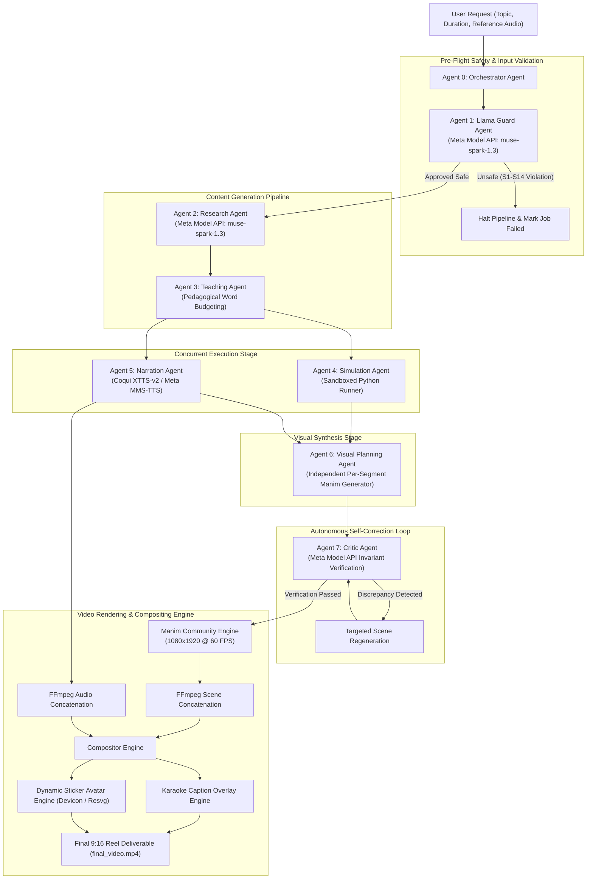

# Concept2Motion

### Autonomous Multi-Agent Engine for Technically Accurate Engineering Reels
*Powered by Meta AI (muse-spark-1.3 / Llama Guard 3) and Manim Community*

---

## Overview

Concept2Motion is an autonomous multi-agent production system that transforms computer science, distributed systems, and kernel architecture topics into high-retention, 9:16 vertical engineering video reels (1080x1920 at 60 FPS).

Rather than prompting generic video diffusion models or generating static bullet-point slide cards, Concept2Motion operates on an executable engineering foundation:

1. **Executable Ground Truth**: Algorithms and protocols run inside sandboxed Python environments to capture runtime states, register values, and mathematical invariants.
2. **Procedural Vector Mechanics**: Visuals are compiled as deterministic Python Manim vector animations (directed DAG nodes, active network links, traveling packet dots, sliding pointers, memory ring buffers, and fault-injection cuts).
3. **Zero-Shot Voice Cloning**: Clones the user's voice directly from a 5 to 15 second uploaded reference audio recording using local GPU-accelerated Coqui XTTS-v2, with fallback to Meta MMS-TTS.
4. **Autonomous Self-Auditing Loop**: An independent Critic agent audits algorithmic invariants against simulation traces and triggers targeted self-correction before rendering.
5. **Anti-AI-Slop Visual Standards**: Enforces restrained visual craft (60-30-10 matte slate palette, `#07090E` background, `DejaVu Sans Mono` terminal typography, no script-mirroring cards, and strict lower-third safe zones for avatar clearance).
6. **Pre-Flight Safety Guardrails**: Evaluates every input topic against the Meta Llama Guard 3 safety taxonomy (S1 through S14) before initiating research or compute.

---

## Complete Architecture



---

## Models and Engines by Component

Every component in the system is mapped to a dedicated model, engine, or runtime environment:

| Pipeline Stage | Component | Model / Engine / Technology | Function |
|---|---|---|---|
| **Pre-Flight Safety** | Llama Guard Agent | Meta Model API (`muse-spark-1.3`) | Evaluates input topics against Meta Llama Guard 3 safety categories (S1-S14). Rejects malicious cyberattacks, exploits, or dangerous content. |
| **Topic Research** | Research Agent | Meta Model API (`muse-spark-1.3`) | Investigates technical topics, protocol RFCs, time complexities, core invariants, and authoritative citations. |
| **Pedagogical Scripting** | Teaching Agent | Meta Model API (`muse-spark-1.3`) | Structures spoken narration into a technical teaching arc with dynamic word budgeting based on target duration (30s, 60s, 90s, 120s). |
| **State Instrumentation** | Simulation Agent | Isolated Python 3.12 Sandbox | Executes algorithmic implementations to capture deterministic ground-truth states (pointers, arrays, hash slots, quorums). |
| **Voice Cloning** | Narration Agent | Coqui XTTS-v2 (`xtts_v2`) | Performs zero-shot voice cloning from user-uploaded audio (.mp3, .wav, .m4a) running locally on CUDA GPU. |
| **Open Speech Synthesis** | Narration Agent (Fallback) | Meta MMS-TTS (`facebook/mms-tts-eng`) | 145 MB lightweight Meta AI speech model used when reference audio is not supplied. |
| **Cloud Speech Fallback** | Narration Agent (Auxiliary) | Microsoft Edge-TTS (`en-US-GuyNeural`) | High-speed neural speech fallback with word-level boundary extraction. |
| **Visual Code Synthesis** | Visual Planning Agent | Meta Model API (`muse-spark-1.3`) | Generates custom Python Manim Community scene classes per narration segment concurrently. |
| **Invariant Verification** | Critic Agent | Meta Model API (`muse-spark-1.3`) | Audits visual storyboard props against Python simulation ground truth; detects and flags mathematical or invariant discrepancies. |
| **Self-Correction** | Orchestrator Agent | Targeted Regeneration Loop | Isolates and re-synthesizes only the discrepant scenes without restarting the full pipeline. |
| **Avatar Generation** | Avatar Service | Devicon CDN + `@resvg/resvg-js` | Selects and renders developer tech stickers (Docker, Postgres, Linux Tux, Rick Sanchez) bounded to the lower-third safe zone. |
| **Vector Animation** | Rendering Service | Manim Community v0.22.1 | Renders vector graphics scenes at 1080x1920 vertical resolution at 60 FPS via Cairo and Pango. |
| **A/V Compositing** | Rendering Service | Bundled FFmpeg (`@ffmpeg-installer/linux-x64`) | Concatenates audio and video tracks, aligns karaoke subtitle overlays, and renders final MP4. |

---

## The Autonomous Agents

### Agent 0: Orchestrator Agent (`OrchestratorAgent.ts`)
- Coordinates the pipeline state machine across all agents.
- Records structured telemetry traces (`AgentTraceItem`) streamed live to the frontend dashboard.
- Manages the closed-loop remediation mechanism when the Critic Agent flags discrepancies.

### Agent 1: Llama Guard Agent (`SafetyGuardrailAgent.ts`)
- Model: Meta Model API (`muse-spark-1.3`).
- Evaluates the input topic against 14 safety categories derived from Meta's Llama Guard taxonomy:
  - S1: Violent Crimes
  - S2: Non-Violent Crimes
  - S3: Sex-Related Crimes
  - S4: Child Sexual Exploitation
  - S5: Defamation
  - S6: Harmful Specialized Advice
  - S7: Privacy and PII Violations
  - S8: Intellectual Property Infringement
  - S9: Indiscriminate Weapons and Explosives
  - S10: Hate Speech and Harassment
  - S11: Suicide and Self-Harm
  - S12: Sexually Explicit Content
  - S13: Malicious Cyberattacks (Ransomware, Exploit Generation)
  - S14: Chemical, Biological, Radiological, Nuclear Hazards
- If a violation is detected, halts the pipeline and logs the specific safety policy violated.

### Agent 2: Research Agent (`ResearchAgent.ts`)
- Model: Meta Model API (`muse-spark-1.3`).
- Investigates technical mechanics, historical origins, RFC standards, and performance characteristics.
- Generates verified concept lists, state transition definitions, and academic/documentation citations.

### Agent 3: Teaching Agent (`TeachingAgent.ts`)
- Model: Meta Model API (`muse-spark-1.3`).
- Enforces word budgeting tailored to duration:
  - 30 seconds: 75 to 85 words (3 segments)
  - 45 seconds: 110 to 125 words (3-4 segments)
  - 60 seconds: 145 to 160 words (4 segments)
  - 90 seconds: 210 to 235 words (5 segments)
  - 120 seconds: 285 to 310 words (6 segments)
- Follows a structured technical pedagogical arc: Hook, Architecture Setup, Step-by-Step Execution, Edge Case / Failure, Invariant / Tradeoff, and Summary Callback.

### Agent 4: Simulation Agent (`SimulationAgent.ts`)
- Runtime: Sandboxed Python Execution Engine.
- Executes Python simulations instrumented with state logging (e.g., hash calculations, array mutations, tree rotations, quorum counter checks).
- Outputs timestamped state objects used as the single source of truth for visual planning and critic verification.

### Agent 5: Narration Agent (`NarrationAgent.ts`)
- Engines: Coqui XTTS-v2 (Zero-Shot Voice Cloning), Meta MMS-TTS, and Edge-TTS.
- Supports voice cloning: user uploads an audio clip (`.mp3`, `.wav`, `.m4a`), which is normalized to a 24kHz mono PCM WAV reference.
- Serializes GPU synthesis calls on 4 GB VRAM devices to safeguard against multi-process CUDA out-of-memory errors.
- Produces individual segment MP3 files and word-level timestamp arrays for karaoke caption synchronization.

### Agent 6: Visual Planning Agent (`VisualPlanningAgent.ts`)
- Model: Meta Model API (`muse-spark-1.3`).
- Synthesizes standalone Python Manim Community scene scripts (`Scene01_...`, `Scene02_...`).
- Generates each scene in parallel with isolated token budgets, eliminating token truncation errors.
- Binds scene objects (`Circle`, `Square`, `Arrow`, `Text`, `VGroup`) to algorithmic simulation states.

### Agent 7: Critic Agent (`CriticAgent.ts`)
- Model: Meta Model API (`muse-spark-1.3`) + Deterministic Rules Engine.
- Deterministic Rule 1: Checks audio-visual segment coverage (scene count must equal narration segment count).
- Deterministic Rule 2: Validates mathematical and pointer invariants against simulation ground truth.
- LLM Audit: Evaluates technical correctness, pedagogical flow, and audio-visual timing.
- Triggers targeted regeneration if any high or critical severity discrepancies are found.

---

## Layout and Motion Standards

The rendering engine strictly enforces vertical video geometric boundaries:

| Geometric Region | Screen Coordinates (1080x1920) | Manim Coordinate Space | Allowed Elements |
|---|---|---|---|
| **Top Header Zone** | `y: 0 to 240px` | `y: 4.8 to 6.6` | Topic badge, progress pill indicator, step labels. |
| **Active Animation Zone** | `y: 240 to 1470px` (Upper 65%) | `y: -1.6 to 4.8` | Manim vector diagrams, code blocks, state machines, arrows. |
| **Avatar & Caption Zone** | `y: 1470 to 1920px` (Lower 23%) | `y: -6.6 to -1.6` | Developer sticker avatar (max 380x450px) and karaoke captions. |

- **Color Palette**: 60% matte slate background (`#07090E`), 30% structural lines and cards (`#1E293B`, `#334155`), 10% semantic accents (`#0EA5E9` blue, `#10B981` green, `#F59E0B` amber, `#EF4444` red).
- **Typography**: `DejaVu Sans Mono` terminal font for labels, code, and values; bold sans-serif font for karaoke captions.
- **Pacing**: Animations complete before narration finishes; static holds allow viewers to absorb diagrams without visual jitter.

---

## Project Structure

```text
meta_ai/
|-- backend/
|   |-- .venv-manim/              # Python virtual environment for Manim Community
|   |-- .venv-voice/              # Python virtual environment for PyTorch CUDA, XTTS-v2, Meta MMS
|   |-- scripts/
|   |   |-- caption_overlay.py            # High-retention karaoke subtitle compositor
|   |   |-- render_captions.py            # Caption generation script
|   |   |-- synthesize_seamless_m4t.py    # XTTS-v2 voice cloning & Meta MMS synthesis
|   |   `-- synthesize_with_words.py      # Edge-TTS word timing extractor
|   |-- src/
|   |   |-- agents/
|   |   |   |-- critic/                   # Invariant auditing & verification
|   |   |   |-- guardrails/               # Meta Llama Guard safety evaluator
|   |   |   |-- narration/                # Neural speech & cloned voice manager
|   |   |   |-- orchestrator/             # Pipeline controller & state machine
|   |   |   |-- research/                 # Deep topic research & citations
|   |   |   |-- simulation/               # Sandboxed Python execution engine
|   |   |   |-- teaching/                 # Script writer & duration budgeter
|   |   |   `-- visual-planning/          # Per-segment Manim code generator
|   |   |-- providers/
|   |   |   |-- meta/                     # Meta Model API (muse-spark-1.3)
|   |   |   |-- tts/                      # SeamlessM4TProvider & EdgeTTSProvider
|   |   |   `-- UnifiedLLMProvider.ts     # Provider routing & diagnostics
|   |   |-- services/
|   |   |   |-- AvatarService.ts          # Sticker avatar fetcher & rasterizer
|   |   |   |-- JobStore.ts               # In-memory & file-based job persistence
|   |   |   `-- VideoRendererService.ts   # Manim compiler & FFmpeg multi-track compositor
|   |   |-- shared/types/                 # Zod schemas & TypeScript definitions
|   |   `-- index.ts                      # Express API server & static media host
|   `-- storage/jobs/                     # Job directories containing audio, scenes, and final_video.mp4
|-- frontend/                             # React, Vite, and Tailwind CSS dashboard
|   |-- src/
|   |   |-- components/                   # Timeline, telemetry HUD, video player
|   |   `-- App.tsx                       # Main dashboard interface
|   `-- package.json
|-- assets/                               # Character stickers (Tux Linux, Rick Sanchez, Homer Simpson)
`-- README.md
```

---

## Setup and Installation

### Prerequisites

- **Node.js**: Version 20.x or higher
- **Python**: Version 3.12 (managed via `uv` or system Python)
- **NVIDIA GPU**: Supported with CUDA (tested on NVIDIA GeForce RTX 2050 4 GB; CPU fallback supported)
- **System Libraries**: `libcairo2-dev`, `libpango1.0-dev`, `pkg-config`
- **FFmpeg**: Bundled automatically via `@ffmpeg-installer/linux-x64`

### 1. Clone the Repository

```bash
git clone <repo-url>
cd meta_ai
```

### 2. Install Node.js Dependencies

```bash
# Install backend packages
cd backend
npm install

# Install frontend packages
cd ../frontend
npm install
cd ..
```

### 3. Setup Python Virtual Environments

The engine uses two isolated Python virtual environments to prevent dependency conflicts between Manim and PyTorch CUDA.

#### A. Voice Cloning & Speech Environment (`backend/.venv-voice`)

```bash
# Create voice virtual environment
uv venv backend/.venv-voice --python 3.12

# Install PyTorch with CUDA 12.4+ support
uv pip install --python backend/.venv-voice/bin/python torch torchaudio --index-url https://download.pytorch.org/whl/cu124

# Install Coqui XTTS-v2, Transformers, SoundFile, and dependencies
uv pip install --python backend/.venv-voice/bin/python "coqui-tts[codec]" transformers soundfile scipy sentencepiece protobuf six
```

#### B. Manim Animation Environment (`backend/.venv-manim`)

```bash
# Create Manim virtual environment
uv venv backend/.venv-manim --python 3.12

# Install Manim Community and rendering dependencies
uv pip install --python backend/.venv-manim/bin/python manim Pillow scipy numpy
```

Verify that Manim is functional:

```bash
backend/.venv-manim/bin/manim --version
# Expected: Manim Community v0.22.x or v0.19.x
```

### 4. Configure Environment Variables

Create `backend/.env` with your Meta Model API credentials:

```env
PORT=4000
FRONTEND_URL=http://localhost:3000

# Meta Model API (dev.meta.ai)
MODEL_API_KEY="your-meta-model-api-key"
META_API_BASE_URL="https://api.meta.ai/v1"
META_TEXT_MODEL="muse-spark-1.3"
META_IMAGE_MODEL="muse-image-1.0"
```

### 5. Launch Development Servers

Start the backend and frontend servers in separate terminals:

```bash
# Terminal 1: Backend Server (runs on port 4000)
cd backend
npm run dev

# Terminal 2: Frontend Dashboard (runs on port 3000, proxies to port 4000)
cd frontend
npm run dev
```

Open `http://localhost:3000` in your browser.

---

## Running Voice Cloning

### Method 1: Via the Web Dashboard
1. Open the dashboard at `http://localhost:3000`.
2. Under **Voice Cloning (Meta SeamlessM4T-v2 / XTTS-v2)**, click the file upload area.
3. Select any 5 to 15 second audio recording (`.mp3`, `.wav`, `.m4a`) of your voice.
4. Enter an engineering topic (e.g. `Docker vs VirtualBox` or `Bloom Filter`).
5. Click **Generate Video Reel**.

### Method 2: Via REST API

```bash
curl -X POST http://localhost:4000/api/jobs \
  -H "Content-Type: application/json" \
  -d '{
    "topic": "Docker vs VirtualBox",
    "audienceLevel": "beginner",
    "targetDurationSeconds": 45,
    "voice": "meta-seamless-m4t",
    "referenceAudioPath": "/absolute/path/to/my_recording.mp3",
    "visualStyle": "minimalist_dark"
  }'
```

### Method 3: Standalone Audio Synthesis Test

To test voice cloning on an isolated text segment without running the full video pipeline:

```bash
backend/.venv-voice/bin/python backend/scripts/synthesize_seamless_m4t.py \
  "Distributed systems coordinate state across independent nodes to guarantee reliability." \
  /tmp/test_output.mp3 \
  /absolute/path/to/my_recording.mp3
```

---

## API Reference

### Health and Provider Diagnostics
```http
GET /api/health
```

**Response**:
```json
{
  "status": "ok",
  "activeLLMProvider": "meta-model-api (muse-spark-1.3)",
  "isRealModelConnected": true,
  "metaModelApiConfigured": true,
  "metaTextModel": "muse-spark-1.3",
  "ttsProvider": "coqui-xtts-v2 / meta-mms",
  "timestamp": "2026-11-05T02:00:00.000Z"
}
```

### Submit Video Job
```http
POST /api/jobs
Content-Type: application/json

{
  "topic": "TCP Three-Way Handshake",
  "audienceLevel": "beginner",
  "targetDurationSeconds": 45,
  "visualStyle": "minimalist_dark",
  "voice": "meta-seamless-m4t",
  "referenceAudioBase64": "data:audio/mp3;base64,..."
}
```

### Retrieve Job Status and Live Telemetry
```http
GET /api/jobs/:id
```

**Response**:
```json
{
  "id": "c2m_1793825477534_ir2py",
  "status": "completed",
  "videoUrl": "/api/jobs/media/c2m_1793825477534_ir2py/final_video.mp4",
  "traces": [
    { "agent": "Llama Guard Agent", "action": "Content Approved", "status": "success" },
    { "agent": "Research Agent", "action": "Research Synthesized", "status": "success" },
    { "agent": "Teaching Agent", "action": "Script Created", "status": "success" },
    { "agent": "Simulation Agent", "action": "States Captured", "status": "success" },
    { "agent": "Narration Agent", "action": "Audio Ready", "status": "success" },
    { "agent": "Visual Planning Agent", "action": "Storyboard Constructed", "status": "success" },
    { "agent": "Critic Agent", "action": "Auditing Artifacts", "status": "info" },
    { "agent": "Video Rendering Engine", "action": "Pipeline Completed", "status": "success" }
  ]
}
```

### Stream Media Deliverables
- Final Video: `GET /api/jobs/media/:jobId/final_video.mp4`
- Full Narration: `GET /api/jobs/media/:jobId/full_narration.mp3`
- Segment Audio: `GET /api/jobs/media/:jobId/seg_01.mp3`
- Subtitle JSON: `GET /api/jobs/media/:jobId/captions.json`
